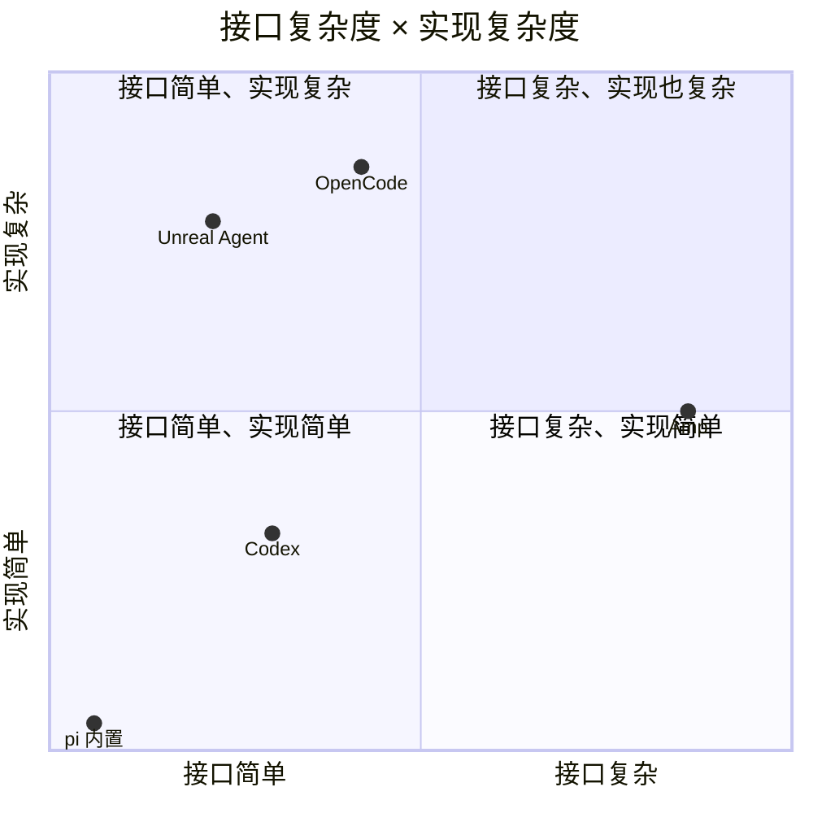

# 横向对照

pi 内置 bash 作基线，四家实现逐一对照。只描述差异。

## 8 问矩阵

| 问题 | pi 内置 | Codex | OpenCode | Amp | Unreal Agent |
|---|---|---|---|---|---|
| 工具数 | 1 | 2 | 1 | 4 | 1 |
| 启动参数 | `command`、`timeout` | `cmd`、`yield_time_ms`、`tty` | `command`、`background`、`timeout` | `command`、`timeout_ms`、`mode` | `command`、`max_output_length` |
| 命令编号 | 无 | `session_id` | `shellID` | `pid` | 无（内部 operation ID） |
| 默认等待 | 无限 | 10 s | 120 s 后杀 | 10 s | 无限 |
| 到点行为 | 杀进程 | 返回，进程继续 | 杀进程 | 返回，进程继续 | 不适用 |
| 再读输出 | 不需读 | `write_stdin` | 无工具，只在文件 | `shell_command_status` | 无工具，等结果 |
| 完成感知 | 调用返回 | 下次轮询才知 | 合成消息 | 可选消息 | 占位结果被真实结果替换 |
| 自动唤醒 | 不适用 | 无 | 有 | 有 | 有 |
| 模型能主动停 | 否 | 否 | 否 | 是（kill） | 否 |
| 重启恢复 | 无 | 无 | 有（KV 标记） | 无 | 有（operation phase） |

## 三种「异步」不在同一层

箭头表示「异步从调用里挪出去的距离」。pi 一点都不挪。Codex 与 Amp 挪到一张表。OpenCode 挪到一个可撤走的 job。Unreal Agent 挪到协议本身，连工具结果都可以不是终态。

## 复杂度两条轴

- pi 两头都最轻。
- Codex 各加一点，模型多个编号，程序多一张表。
- Unreal Agent 接口极简，内部最重，要维护 operation phase、会话存储、心跳、结果替换。
- OpenCode 内部同样重，但多一层「通知不丢」的保证。
- Amp 接口最重，内部只需要 pid 表、输出缓冲和等待者。

## 完成通知对照

| 产品 | 形态 | 进模型上下文 | 触发新一轮 |
|---|---|---|---|
| pi 内置 | 调用当场返回 | 是 | 不适用 |
| Codex | 无，只有界面事件 | 否 | 否 |
| OpenCode | 合成消息 `<shell id state command>` | 是 | 是，`resume:false` 除外 |
| Amp | user 消息，带 `fromSubagentToolUseID` | 是（观察到的形态） | 是（推断） |
| Unreal Agent | 同一条工具结果从占位换成真实值 | 是 | 是 |

## 挂死的命令

| 产品 | 模型能看到什么 | 模型能做什么 |
|---|---|---|
| pi 内置 | 没有信号，只能等或超时 | 无 |
| Codex | 没有信号 | 无，只能继续轮询 |
| OpenCode | 没有信号 | 无，后台不限时 |
| Amp | `silentFor` 沉默时长 | `shell_command_kill` |
| Unreal Agent | 心跳反复提示还在跑 | 无，只能等用户停 |

## 输出预算

| 产品 | 单次上限 | 完整输出 |
|---|---|---|
| pi 内置 | 2000 行或 50 KB | 临时文件 |
| Codex | 1 MiB 缓冲、1 万 token 预算 | 无独立文件 |
| OpenCode | 行数与字节双限 | 文件保留 7 天 |
| Amp | 50000 字符环形缓冲 | 无 |
| Unreal Agent | 默认 40000 字符，上限 100 万 | 会话目录下 `out`/`err` |

## 共同点

- 都不靠 `&` 或 `nohup` 把进程丢给 shell，都自己持有进程句柄。
- 都把「等待窗口到期」与「进程结束」分成两个结果。
- 都在输出上设硬上限，截断时给出可定位的说明。
