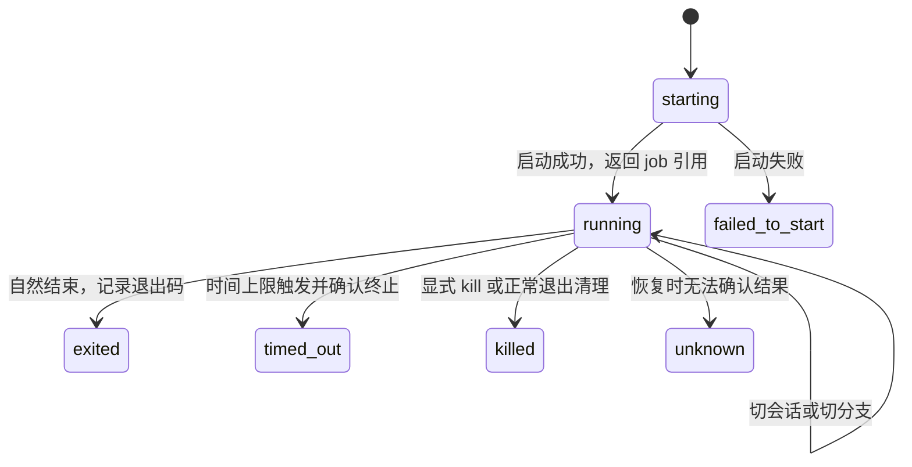

# bash 后台执行：当前 pi 上的调查与最小验证

## 结论

核心目标可行：工具启动长任务后返回，真实 AgentSession 可以在该任务结束前处理另一条用户请求；结束事件可以继续驱动模型 turn。

推荐保留 `bash(background?: boolean)` 和一个 `bash_job` 控制工具。需要修改原方案的生命周期、统计解释和通知保证。当前证据不足以直接进入原方案的完整实现。

本次没有调用外部模型 API，没有修改 pi 安装文件、全局设置或原有会话。当前工作目录原先为空，且不在 Git 仓库中。新增内容仅为本文和 `probes/` 下的调查脚本。

## 1. 验证环境与方法

- 实际启动器：`/Users/ziqian/.pi/agent/bin/pi`，`pi --version` 返回 `1.3.0`。
- Node：`v22.23.2`；操作系统：macOS。
- 安装包根目录，以下简称 `$PI`：
  `/Users/ziqian/.pi/agent/install/releases/1.3.0/node_modules/@earendil-works/pi-coding-agent`
- 阅读安装包内官方文档、示例和未打包发布代码，直接导入该安装包 SDK 做实验。
- 模型端使用已注册的本地确定性 provider。AgentSession、AgentSessionRuntime、扩展事件、会话文件和子进程都是真实实现。
- 原始 JSONL 抽查四类代表样本，不重新计算全部统计。目前可见 365 个会话文件，与原统计的 364 个属于不同快照。

代码指纹：

```text
dist/core/tools/bash.js
f32e87a42f66276b2eafaaf0848babf52523d37ab0fd448439586376747f03c4

dist/core/agent-session.js
d0b4545a5da7fe97aa699269e64e27b37ee2fb5b7985efb1c0a66fc3d1883b52
```

本次验证的是 SDK 运行机制。没有操作真实 TUI 键盘，没有验证打包 CLI 的全路径，也没有检验商业模型是否会正确选择 `background`。

## 2. 原统计中需要修正的推断

### 2.1 累加调用时长不能直接当成用户等待时长

原始样本：

```text
会话：2026-08-30T16-43-38-711Z_01a0538e-2157-75f1-a9d3-1ba4b4ea2ede.jsonl
第 8 行：同一 assistant 消息含三个 bash toolCall。
assistant 条目时间：16:45:53.807
第 9、10、11 行：三个 toolResult 条目时间均为 16:45:54.150。
```

三个调用共用一个起点。按条目时间分别相减再累加，得到 1.029 秒；该批次的记录窗口只有 0.343 秒。

因此，“同一消息内兄弟调用时间独立、互不重叠”的说法被反例推翻。原来的 13.7 小时和 45.2% 至多先视作按调用累计口径，不能直接解释为用户实际等待或可节省的时间。没有原分析脚本，无法确认它是否另做了去重；本次也不重算比例。

另一个时间口径问题：同一样本的内层 `message.timestamp` 为 16:45:42.608，比 assistant 条目时间早 11.199 秒。若使用这个起点，会把工具执行前的生成时间也计入。后续度量应优先记录 `tool_execution_start/end`；历史数据缺少执行起点时，应明确使用的是近似窗口。

来源：上述原始 JSONL 第 8–11 行；`$PI/dist/core/agent-session.js:1766`；Agent 核心的 `dist/agent-loop.js:411–457`。

### 2.2 没有用户 transcript 条目，不代表输入不能提交

实验在前台 `sleep 0.6` 运行期间调用真实 `session.steer()`：

1. 提交成功。
2. 当时的持久化分支没有这条 user 消息。
3. 前台工具批次结束后，消息才出现在会话中。

TUI 的提交路径也会在 streaming 时调用 `session.prompt(..., { streamingBehavior: "steer" })`。

所以原统计不能区分“没有打字”和“已经提交、正在排队”。当前能确认的阻塞是：**模型无法在当前工具批次结束前处理排队输入**。没有证据表明整个输入界面被冻结。

来源：`$PI/dist/modes/interactive/interactive-mode.js:2717–2725`；`$PI/dist/core/agent-session.js:1635–1647,1766–1780`；`probes/runtime.mjs` 的 `foreground_steering`。

### 2.3 尾部和手写异步现象确实存在，但分类不能代替原因

抽查确认：

| 样本 | 观察 |
|---|---|
| 长调用，第 48–49 行，`2026-08-30T15-15-40-687Z_01a0533d-980f-7f0b-afd2-34219e716c3b.jsonl` | git clone 调用窗口 94.313 秒，最终 checkout 失败 |
| 手写后台，第 31–32 行，`2026-09-01T16-13-38-811Z_01a05dbf-627b-7eb9-b095-a1dd83970854.jsonl` | `npm ci` 后用 nohup 启动服务，再 sleep、tail；40.630 秒的大部分来自安装 |
| sleep 轮询，第 115–116 行，`2026-10-11T04-57-03-693Z_01a12952-53cc-705c-9e3c-bfd68c518529.jsonl` | 先 sleep 60，再读进程状态、日志尾部及文件大小；窗口 60.034 秒 |

sleep 本身不提供信息，后面的状态和日志查询提供信息。完成通知可替代“只为等结束”的轮询，不能据此承诺消除所有 readiness 或进度查询。

这些样本支持继续做最小验证，不能单独证明全部比例准确或后台参数能覆盖全部尾部。

精确文件路径、行号和时间戳可由 `probes/session-evidence.py` 重新输出；脚本不导出命令正文或日志正文。

## 3. 原方案逐项判断

| 原判断 | 调查结果 |
|---|---|
| 同名 bash 加可选参数 | 可由扩展覆盖内置工具，前台可委托原定义；方向可用 |
| 工具返回后能继续对话 | 已在真实 SDK 会话验证 |
| 长调用可能在等待 stdin | 当前 macOS bash 默认 stdin 为 ignore；`read` 实测立即失败。不能用此解释当前实现的一般长等待；通过 `/dev/tty` 等访问输入的程序另论 |
| 后台就应在 pi 退出后继续 | 产品选择，无法从 `background` 或历史日志推出 |
| detached 后还必须调用 setsid | 当前平台不需要；实测 PID=PGID=SID，本机无 setsid 可执行文件 |
| PID 探活可恢复任务 | 只能辅助探活，不能恢复退出码，也不能单独证明进程身份 |
| job 属于 session，fork 后自然共享 | `/tree` 留在同一 session；`/fork` 创建新 session。继承的 job 引用必须保留原 owner，不能用新 session ID 重新解释 |
| 旧回调继续发送完成消息 | 不成立。切会话或 reload 会使旧 ExtensionAPI 失效；实测旧 `sendMessage` 抛 stale 错误 |
| 状态上下文解决重复通知 | 方向可用，但必须分别定义自动唤醒、分支上下文和持久化确认 |
| 只截尾部 100 行足够 | 不足。单行也可有 300KB；必须同时限制字节数 |
| kill 保证整个进程树消失 | 当前 Unix 实现杀进程组。自行创建新组的后代可逃离；已构造反例 |
| 后台忽略 timeout | 不推荐。调用者明确给出的时间上限应继续生效 |

主要源码：

- 执行、stdin、进程登记、timeout、abort：
  `$PI/dist/core/tools/bash.js:48–123`。
- bash 定义、输出协议和工厂：
  `$PI/dist/core/tools/bash.js:156–334`。
- 进程登记和进程组终止：
  `$PI/dist/utils/shell.js:141–185`。
- 消息四种投递分支：
  `$PI/dist/core/agent-session.js:1815–1878`。
- 扩展失效和异步发送错误处理：
  `$PI/dist/core/agent-session.js:996–1014,2736–2744`；
  `$PI/dist/core/extensions/loader.js:302–304`。
- session replacement、fork 和退出：
  `$PI/dist/core/agent-session-runtime.js:102–118,174–248,296–304`。
- TUI 正常关闭、信号关闭和紧急进程清理：
  `$PI/dist/modes/interactive/interactive-mode.js:3486–3593`。
- 工具覆盖、通知示例：
  `$PI/examples/extensions/tool-override.ts`、
  `$PI/examples/extensions/send-user-message.ts`。

## 4. 推荐的最小方案

以下是设计建议，不代表已实现。

### 4.1 接口保留，语义收窄

```typescript
bash({ command, timeout?, background?: boolean })
bash_job({ job_id, action: "status" | "wait" | "kill" })
```

- 前台：委托已有 bash 定义，保持输出、错误、超时、取消及结构化协议。
- 后台：返回确认启动的 job 引用；启动失败直接报错，不能先承诺 running。
- `timeout`：仍是最大执行时间，超时终止作业并记录 `timed_out`。省略时不设置上限。
- Escape：停止当前 turn；已经确认启动的后台任务继续。
- `wait`：主动阻塞，结束时返回结果。取消 wait 只停止等待，不杀作业。
- `kill`：显式终止作业进程组。不能声称能控制自行 daemonize 的后代。
- `status`：用于用户要求查进度、检查 readiness 或诊断；不作为默认轮询。

保持一个新增参数、一个新增工具。后台与前台的输出形状需要显式 union；后台没有退出码时，不能沿用要求 `exit_code: number` 的旧 schema。必须返回匹配的 `structuredContent`，仅放 `details` 不满足 codemode 的程序调用契约。

job ID 应唯一，记录原 owner session ID 和原工作目录。fork 继承的是引用，不复制进程，也不改变原 owner。

`Started` 只表示已启动。启动服务后是否开始监听，不在首版自动判断范围内。

### 4.2 首版不承诺退出后继续运行

推荐：

- `/tree`：作业继续，所有分支读取同一份会话作业状态。
- `/new`、`/resume`、`/fork`、reload：作业在当前 pi 进程内继续；旧通知订阅解除，新运行时重新绑定。
- 正常退出 pi：清理后台作业，尽量记录终止结果。
- 异常退出：不承诺存活，也不根据 PID 消失猜测退出码；无法确定结果时标记 `unknown`。

理由：释放当前 turn 已能实现核心目标。退出后存活会增加结果记录者、恢复和孤儿进程处理，这些能力尚无已确认需求。保留已有清理方向，可以少引入一种生命周期承诺。

实现上优先评估复用 `createLocalBashOperations()`：后台执行使用作业自己的 AbortController，日志写文件；不要把已交付作业继续绑定到启动 turn 的 signal。正常 quit 必须主动清理；不能只依赖紧急退出路径的 PID 登记。

跨 session replacement 的作业管理器必须是进程级共享状态。退出事件只更新作业状态，不捕获旧 `pi` 或 `ctx`。具体扩展加载方式下的共享与 reload 行为仍需实现时验证。

单纯在 `execute()` 里启动 Promise 然后返回，若其完成回调仍引用旧 ExtensionAPI，会在切会话后失败。



`kill` 请求、超时触发和真实退出可能竞态。状态应依据观察到的终止结果及触发原因确定，不能在发出 kill 请求时就伪造“已终止”。

### 4.3 完成状态和自动唤醒分开

需要三个事实：

1. 作业最终结果，独立于 transcript。
2. 当前活跃 session 是否可以接收该作业事件。
3. 该完成事件是否已经进入该 session 的 transcript。

建议用稳定的完成事件 ID，例如 job ID 加终态版本。

- 作业先记录终态；活跃 owner session 才投递 `custom` 完成消息。
- 需要空闲时继续分析，必须指定 `triggerTurn: true`。仅有 `deliverAs: "followUp"` 不能表达这个意图。
- 不构造第二条同 toolCallId 的 toolResult；原启动工具调用已经返回。
- `pi.sendMessage()` 返回 void，不是持久化 ACK。不能把“调用发送”直接记为“完成通知已送达”；要观察实际消息事件/持久化条目。
- 切会话时待投递消息可能随旧运行时消失；终态仍保留，回到 owner 后可读取。
- `/tree` 的另一分支缺少那条通知时，按状态构建简短上下文；不因切分支再次自动唤醒。
- `/fork` 只允许继承可见 job 引用的查询/等待/显式控制；新 session 不自动订阅原 owner 的完成唤醒。

原型证明这个调度方向可行。没有证明跨崩溃 exactly-once 自动处理；首版不要做这项保证。恢复状态可读与模型副作用恰好执行一次是不同承诺。

### 4.4 日志有两种预算

- 完成通知：状态、退出码或信号、时间、完整日志路径和计数；尾部最多 100 行且最多 16KiB。
- 恢复上下文：只放必要状态，不每次重放完整尾部；同一请求中的作业恢复上下文也要有总预算。

16KiB 是建议起点，不是实验推导出的最优值。不增加可配置项。实验只证明行数上限不足，并验证已有 `truncateTail` 能处理 UTF-8 字节上限。

日志读取也应有内存上限，不能为了输出 16KiB 先把任意大的文件读进内存。

### 4.5 为什么不建议忽略 timeout

| 选择 | 后果 |
|---|---|
| 保留终止语义，推荐 | 尊重显式时间上限；后台与前台一致，须区分 timed_out |
| 拒绝 background 与 timeout 同时使用 | 语义明确，但调用者失去后台执行上限 |
| 忽略 timeout | 接受参数却不履行限制，进程可能运行远超过调用者预期 |

应先停止进程，再发送超时结果。取消当前 turn 或 wait，不应冒充超时。

## 5. 实验结果与可检查记录

运行：

```bash
node probes/runtime.mjs
node probes/process-lifecycle.mjs
python3 probes/session-evidence.py
```

不安装依赖；默认导入本机 pi 1.3.0，可通过 `PI_PACKAGE_ROOT` 指定另一个安装包路径。脚本创建临时会话、日志和短生命周期子进程；会终止自身实验启动的进程组。它们不加载个人扩展或真实凭证。

### 5.1 真实 SDK 会话，12 项检查通过

| 检查 | 结果 |
|---|---|
| 前台期间提交 steering | 可排队，工具结束前不进 transcript，结束后可见 |
| 前台成功输出 | stdout/stderr 与内置定义相同 |
| 前台失败输出 | 与内置定义相同，code 9 标记为错误 |
| stdin | `read` 立即返回失败 |
| 前台超时和 abort | 拒绝调用并保留部分输出 |
| 后台失败及对话继续 | 用户请求先被处理，随后收到 code 7，一条通知 |
| 后台成功 | code 0，一条通知 |
| 切会话及恢复 | 旧 API 被拒绝，新会话没有错收，恢复后请求能读终态 |
| `/tree` | session ID 不变，无自动重放 turn，请求可读缺失通知对应的状态 |
| `/fork` | 新 session ID，继承引用可读，原 owner 不变 |
| 尾部预算 | 单行原文 300,000 字节，截断后 16,383 字节 |
| detached | PID、PGID、SID 均为 65924；本机 setsid 不存在 |

关键时间顺序，来自同一进程的单调时钟：

```text
j1 启动：                  1210.531 ms
另一条用户请求进入 provider：1212.566 ms
j1 退出：                  2220.891 ms
```

这证明用户请求确实在作业未结束时被处理。

完整运行记录：`/tmp/pi-async-runtime-probe.log`。
临时会话与作业日志：`/var/folders/zh/qf_nccyd0_b0fc84rk8dl4lm0000gp/T/pi-async-investigation-TAvMwr`。

原型有意使用进程内 Map，只验证正常运行、切换和上下文机制。它不是可安装扩展，没有实现生产级落盘恢复、完整后台 outputSchema、bash_job、reload 管理或退出清理契约；不能将其通过视为这些功能已经完成。

### 5.2 操作系统生命周期，3 项检查通过

- 启动器进程退出后，独立的一次性 worker 继续运行，记录 shell 的 code 23 和完整输出。
- 同样的 worker 在启动器退出后仍执行 180ms timeout，记录 `timed_out`、SIGKILL 和部分日志。
- 杀掉 shell 所在进程组后，主动 detached 的后代仍存活；测试随后清理该后代。

worker 仅用于检验“退出后继续”方案需要什么，不属于推荐首版。没有启动常驻守护进程。

记录：`/tmp/pi-async-lifecycle-probe.log`。

这里退出的是实验启动器，未执行真实 pi 退出/重启。因此不能声称已经验证 pi 退出后任务恢复。

如果将来确认必须退出后继续，一次性 worker 是可行候选：由它等待命令、执行 timeout、原子写终态；无需常驻 daemon。仍需验证真实 pi 退出/重启、worker 异常和身份恢复，不能用当前实验代替。

### 5.3 原始证据记录

`/tmp/pi-async-session-evidence.json` 保存四类样本的文件位置、行号和时间戳；不含命令正文和日志正文。

## 6. 后续实现的完成条件

1. 前台在真实扩展注册路径中保持原有参数、输出、isError、超时、abort 和 codemode 结构化结果。
2. 通过真实 TUI 或 RPC 路径证明后台长任务未结束时，用户新请求已处理；保留事件顺序记录。
3. 后台成功、非零退出、启动失败、超时和显式终止都能得到正确终态；日志截断有字节上限。
4. Escape 与 wait 取消不误杀已启动后台任务；显式 kill 能终止普通子进程组。
5. 作业运行中切会话、fork、切分支及 reload，不调用 stale API、不投错会话、不因恢复反复触发自动 turn。
6. 正常退出 pi 清理该进程管理的作业；异常退出后无法确定结果时不伪造退出码。
7. 原工具覆盖与现有 shell 配置、spawn hook、其他覆盖扩展的相容性已检查；后台结构化 union 已通过程序调用验证。

剩余风险集中在生产生命周期与通知持久化交界，不在“Node 能否后台启动进程”。

外部模型 API 当前不是阻碍。以后检验模型会否恰当地选择后台、避免轮询，以及真实服务商接不接受工具输出协议时，才需要少量授权后的真实调用。
