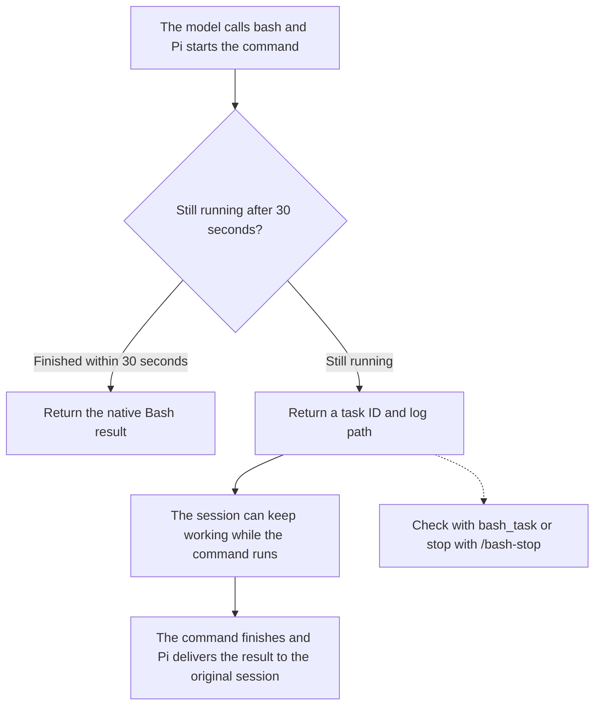

# Async Bash for Pi

[简体中文](README.zh-CN.md)

Keep working in Pi while a build or test runs. In interactive and RPC sessions, a command that is still running after 30 seconds moves into the background. The same process keeps running, and Pi delivers its result to the session that started it.



## Quick start

### Install and enable Code Mode

Tested with Pi 1.6.0. For everyday use, enable Code Mode in `on` mode.

```bash
pi install npm:@runminton/pi-async-bash
pi --tools +codemode
```

To try it for one run, use `pi -e npm:@runminton/pi-async-bash --tools +codemode`.

`--tools +codemode` adds Code Mode for this run and keeps the default tools. To enable it on every run, merge these settings into `~/.pi/agent/settings.json` or the project's `.pi/settings.json`. If you already use `defaultTools`, keep your existing selection and make sure it enables `codemode`.

```json
{
  "defaultTools": ["+codemode"],
  "codemode": { "mode": "on" }
}
```

`on` is the default mode once Code Mode is enabled. With Code Mode disabled, the model can still call `bash` and `bash_task` directly. In `only` mode, those two tools remain directly callable, `bash_sync` stays available to scripts, and built-in tools such as `read` and `edit` move into scripts.

### What changes after installation

The extension registers three tools. It takes over Pi's existing `bash` entry point and adds two tools.

| Tool | Where it runs | What it does |
|---|---|---|
| `bash` | Direct model call | Uses Pi's native Bash execution and the existing `command` and `timeout` parameters. Short commands return the native result. Long commands hand off automatically. |
| `bash_task` | Direct model call | Checks a task's status and log tail by ID, or waits for its result for a set time. |
| `tools.bash_sync` | Code Mode script | Uses the same native Bash execution so the script can continue with the command's result. |

The extension uses Pi's configured shell path and command prefix. Any other extension that registers `bash` conflicts with this one. In one-shot runs (`pi -p` and `pi --mode json`), `bash` stays in the foreground until the command finishes, times out, or is cancelled.

### Check or stop a background task

- If the original session is idle, Pi starts a turn to process the result. If the session is busy, the result arrives with the next model call. If you switch sessions, the result waits until you return.
- The terminal status bar shows background tasks and elapsed time for the current session. Once a command ends, it shows `result pending` until the result reaches the conversation.
- Enter `/bash-stop <task_id>` in Pi to stop a handed-off task. On normal exit, Pi stops managed tasks and cleans up their logs. Task ownership stays with the original session when you fork.

### Why the tools are split this way

One `bash` call covers both fast and slow commands. Elapsed time determines when the call hands off. Scripts use `bash_sync` when their next step needs the output and exit code. Live task state stays in the task record and terminal status bar. Pi appends completed results to the conversation, preserving the existing context.

### Upgrading from 0.1.2

Handoff now starts after 30 seconds, down from 63. Replace `action: "status"` calls with `bash_task({ task_id, wait_seconds: 0 })`. For the old `action: "kill"`, enter `/bash-stop <task_id>` in Pi. In Code Mode scripts, replace `tools.bash` with `tools.bash_sync`.

## Run from source

Load the extension from this checkout with Pi 1.6.0.

```bash
npm ci
pi -e ./index.ts
```

## Tool details

```typescript
bash({ command: "npm test", timeout: 120 })
```

`timeout` is the native Bash execution limit in seconds. Omit it for no execution limit. In interactive and RPC sessions, commands that finish within 30 seconds return the native Bash result. Commands still running return `status: "running"`, `task_id`, and `log_path`. Execution and the timeout clock continue after handoff.

```typescript
bash_task({ task_id: "650e2e", wait_seconds: 5 })
bash_task({ task_id: "650e2e", wait_seconds: 0 })
```

The task ID is six hexadecimal characters and also works with `/bash-stop`. `bash_task` accepts a wait of 0–300 seconds and defaults to 30. Use `0` for an immediate snapshot. If the command finishes during the wait, the final result returns immediately. Cancelling the wait or reaching its limit leaves the command running. A running result shows elapsed time. A final result or completion message shows total execution time.

Task lookups and completion messages include up to 40 lines and 4 KiB from the end of the log. `Captured output` means the command timed out or was stopped and all captured output fits in the preview. For truncated output, use the log path and `read` with an `offset` to see earlier lines. `start_line` and `end_line` are one-based positions in the full log. If the last line alone exceeds the byte limit, the preview identifies the visible text as the end of that line.

## Run commands in Code Mode scripts

Mixed mode keeps `bash` and `bash_task` directly available and exposes `bash_sync` to scripts.

```bash
pi -e ./index.ts --tools +codemode
```

```typescript
const result = await tools.bash_sync({ command: "git status --short" });
return result.output;
```

`bash_sync` waits for a native Bash result and returns structured output even when the exit code is nonzero. If output exceeds 1 MiB, `truncated` is `true` and `full_output_path` points to the full output. A command timeout throws an exception that the script can catch. Execution occupies a Code Mode worker and is subject to the command's `timeout` and the script's `timeout_ms`. Use a direct `bash` call for long commands that can run in the background.

## Task lifecycle

- If a direct `bash_task` call returns the final result, Pi skips the separate completion message. The same ID remains available for later lookups.
- Cancelling `bash` before handoff stops the command. After handoff, use `/bash-stop <task_id>`.
- The current Pi process keeps full task logs and builds previews on demand. Normal exit stops managed tasks and removes handoff logs.
- A fork inherits tool messages in the conversation history. Task lookup, stopping, and completion delivery stay with the session that started the command.

## Compatibility

- One-shot print and JSON modes run in the foreground so the result can be returned before Pi exits.
- In Pi 1.6.0, an explicit list such as `--tools bash,bash_task` filters extension registration. Explicitly listing `bash_sync` exposes it directly to the model as well. Use `--tools +codemode` to keep the default tool split.
- In `only` mode, Pi hides tools with `direct` exposure. The extension's `model-only` tools, `bash` and `bash_task`, remain directly callable.

## Development

```bash
npm run check
npm test
```

Tests use Pi 1.6.0, real shell commands, and an offline model. The RPC tests save event traces, and the cache regression test saves requests serialized by the OpenAI adapter. `test/one-shot.test.mjs` runs the real CLI in print and JSON modes. Test output lists the temporary directories.

- For tool contracts, see [SPEC.md](SPEC.md). For completion delivery, prompts, or logging, start with [T11's maintenance notes](.scratch/bash-task-handoff/issues/01-bash-task-handoff.md#维护要点).
- For tool descriptions, `promptSnippet`, or `promptGuidelines`, see [model-visible prompt design](PROMPT_DESIGN.md) for the role and rationale of each layer.
- For `exposure`, `--tools`, or visibility assertions, see [Pi tool visibility](PI_TOOL_EXPOSURE.md) for observed declarations in all three modes.
- For handoff or wait thresholds, see [threshold measurements](THRESHOLD_ANALYSIS.md). For comparisons with other agents, see the [async shell research index](.scratch/async-bash-research/README.md).
- [TICKETS.md](TICKETS.md) records implementation history and acceptance checks. Before changing the extension, read [PROJECT_MEMORY.md](PROJECT_MEMORY.md) for decision rationale, deferred issues, and verification limits.

## License

MIT
