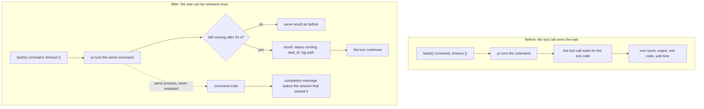

# Async Bash

Long bash commands no longer hold a tool call hostage.

> **Beta.** The extension works and is published, but some of its design is still unsettled. Treat it as usable for daily work, not as a stable interface.
>
> Known design difficulties:
>
> - **Completion delivery is scheduled by pi, not by this extension.** A finished task sends one message through pi's steering queue. Delivery happens at a turn boundary the host chooses, and it does not interrupt a running tool batch. In a real session, one completion was observed arriving about 104 minutes late. The extension cannot bound that latency; the most it can do is hand the message over as early as the host allows.
> - **It depends on host internals.** The handoff reads the local shell backend, and the notification relies on delivery and settle hooks in pi 1.3.0. A pi release that changes those paths can break the extension quietly, without a load error.
> - **The 63-second threshold is a fixed waiting time, not a configured value.** It is chosen to sit under the default tool timeout and is not adjustable per project.
> - **It cannot compose another execution backend.** Any other extension that also registers `bash` conflicts with this one; pi picks a definition by load order instead of composing two backends.
> - **Background state is process-local.** Tasks do not survive quitting pi, are not adopted across processes, and descendants that leave the process group are not tracked.
>
> Verified on pi 1.3.0, Node 22.23.2 and macOS only. Windows is untested.

## What installing it changes

One changed behaviour and one new tool:

1. A `bash` call still running after 63 seconds returns a task ID instead of blocking. The command keeps running and the session is notified when it ends.
2. `bash_task` is added, so the session can check or stop those tasks.



### The bash interface is unchanged

| | |
|---|---|
| Tool name | `bash` |
| Parameters | `command` and `timeout`, same schema and validation. There is no `background` parameter, so the model never guesses how long a command will take |
| Shell | Same `shellPath`, `shellCommandPrefix`, session environment (`PI_SESSION_ID` and friends) and `tool_call` policies |
| Foreground | Same native execution code, wrapped only to copy output into a log. Same output text, same truncation to 2000 lines / 50 KB, same exit code and error marking |
| Timeout | Still an execution limit. A `timeout` of 63 seconds or less never hands off |

Three things about the tool definition do differ:

- The description ends with one sentence that tells the model about the handoff.
- The declared output schema accepts a normal result or a `running` result.
- In the TUI, the bash tool no longer supplies a result renderer, so pi's generic renderer draws the result body instead of the built-in bash result widget.

### What gets added

| Addition | Effect |
|---|---|
| `bash_task` tool | `status` and `kill` for tasks owned by, or inherited by, the current session |
| Footer status | TUI only, for example `BG 1 · 2m 10s`, refreshed every second |
| Completion message | When a handed-off command ends, one message reaches the session that started it and may start a turn |
| Context note | While tasks exist, a hidden `async-bash-state` message joins model requests, capped at 16 KiB |
| Session entry | Each handoff appends an `async-bash-task` entry to the branch |
| Files | `<agent dir>/extension-data/async-bash/` (0700) gets one `.log` per bash call, short calls included, and one `.json` per handed-off task. Nothing is deleted automatically |

Two behaviours change only after a handoff:

- Escape stops the turn, not the background command. Use `bash_task` with `kill`.
- Quitting pi stops tasks owned by that process.

### What it does not do

- It writes no settings. `pi install` registers the package; the extension reads `shellPath` and `shellCommandPrefix` and changes neither.
- It touches no project files, starts no daemon and opens no network connection.
- It makes no model calls of its own. A completion message starts an ordinary turn, using your configured model like any other turn.
- It does not adopt tasks across processes, and it does not compose another extension's private spawn hook, SSH or sandbox backend.

## Install

```bash
pi install npm:@runminton/pi-async-bash
```

Or load it for one invocation without changing your settings:

```bash
pi -e npm:@runminton/pi-async-bash
```

Installing modifies your pi configuration explicitly through `pi install`. Loading with `-e` does not.

Verified on pi 1.3.0, Node 22.23.2 and macOS. Implementation reuses pi's local shell backend; Windows is untested.

Do not load another extension that overrides `bash` at the same time. pi 1.3.0 reports duplicate tools as a conflict and selects a definition by load order; it does not compose two execution backends. This extension honours the standard `shellPath`, `shellCommandPrefix` and `tool_call` restrictions.

With a version of `pi-compact-tool` that no longer overrides bash execution, async-bash executes and compact renders; both load orders work. Older compact versions still register bash and must be updated together.

## Usage

Normal bash parameters are unchanged:

```typescript
bash({ command: "npm run e2e", timeout: 600 })
```

For work whose result you need, run the command in the foreground. Do not wrap it in `nohup ... &` and then wait with `sleep; tail`: the shell returns after launching the process, so this tool cannot track its completion. The tool already handles long commands and keeps their logs.

If the command is still running after 63 seconds, the call returns:

```text
Still running after 63 seconds. Task: <task_id>
Log: <absolute_log_path>
You will be notified when it finishes. Do not poll.
Continue work that does not depend on this result. If none remains, end your turn and resume when notified.
```

Then, on demand:

```typescript
bash_task({ task_id: "...", action: "status" })
bash_task({ task_id: "...", action: "kill" })
```

New task IDs are 8 random hexadecimal characters, for example `a3f8c921`, regenerated on collision. Existing UUID tasks remain readable and controllable.

| Action | Behaviour |
|---|---|
| status | Returns the status, log location and a bounded log tail |
| kill | Stops the managed process group and returns after observing the result; a finished task keeps its original result |

`timeout` is the execution limit for the whole command. A background handoff does not restart it. The 63 seconds are a waiting threshold, not an execution timeout.

`bash_task` no longer supports `wait`, and `bash` gains no synchronous waiting parameter. After a running result, continue work that does not depend on it; when nothing is left, end the turn and resume when notified.

Completion messages are delivered at the next available turn boundary, even while the agent continues calling tools. They do not interrupt a running tool batch. They use steering delivery rather than a follow-up queue, which would wait for the agent's entire tool loop to stop.

## Footer

In the TUI, current-session background tasks appear through pi's native status API. The footer itself is not replaced and compact is not required:

```text
BG 2 · 3m 12s / 1m 05s
```

Each duration counts from when its command actually started, including the foreground 63 seconds. Entries are ordered by start time and refresh every second; IDs are not shown. A finished task is removed immediately, and the status disappears when nothing is running. Foreground commands and `unknown` tasks from an earlier runtime are never counted.

Narrow terminals drop spaces inside durations first, then report omitted entries as `+N`, for example `BG 2 · 3m12s / +1`. The native footer still applies its single-line truncation to all extension statuses.

Switching sessions only shows tasks the current session owns or inherits by reference. The compact tool row shows `Backgrounded` to record that a handoff happened at that point; the footer shows what is running now, and the completion notification carries the final result.

## Lifecycle

- Before a task ID is returned, Escape cancels the running command.
- After a task ID is returned, Escape does not stop that task; use kill.
- `/tree`, session switching, fork/clone and reload do not stop tasks.
- Completion notifications wake only the owning session. Returning to another branch adds state but does not replay the automatic notification.
- fork/clone inherits the same task ID without copying the process; an inheriting session can query and stop it explicitly.
- A normal pi exit stops tasks managed by the current process.
- After a crash, task survival and cleanup are not promised. A new runtime marks executions it cannot confirm as `unknown`; it does not guess an exit code or adopt or stop anything based on a stale PID.
- Long-running services usually never exit on their own. A `running` task does not mean a service is ready to accept requests.

Automatic handoff releases only that one bash call. When the same batch contains other blocking tools, the current turn may still have to wait.

## Output and state

Completion notifications and `status` include at most 100 log lines and 16 KiB. Restored context has a separate 16 KiB total budget and does not repeatedly inject full logs.

Statuses are `running`, `exited`, `killed`, `timed_out`, `failed` and `unknown`. A non-zero exit is still `exited`, with the exit code kept separately. Querying a failed task with `status` is not itself a tool error; `kill` on a failing terminal state is marked as an error.

Inside codemode:

- Short bash calls return the original structured fields such as `output` and `exit_code`.
- Long bash calls return `task_id`, `status: "running"`, `log_path` and similar fields, with a null exit code.
- `bash_task` returns task status and a bounded `output`; scripts should check status and exit code.

There is no automatic log cleanup, PTY, automatic retry, task list or cross-process task adoption. Termination is guaranteed only for the managed process group, excluding daemon descendants that deliberately leave it.

## Development

```bash
npm ci
npm run check
npm test
```

Tests use a local deterministic provider, real AgentSessions, real CLI/RPC and real child processes. No external model API is called. The suite performs several real 63-second handoffs and usually takes four to five minutes.

RPC tests print a temporary artifact directory that keeps each process's `events-<pid>.jsonl`, `stderr-<pid>.log`, session and command logs.

Local implementation notes are in `TICKETS.md`, the acceptance contract in `SPEC.md`, and research evidence in `INVESTIGATION.md`.

## License

MIT
